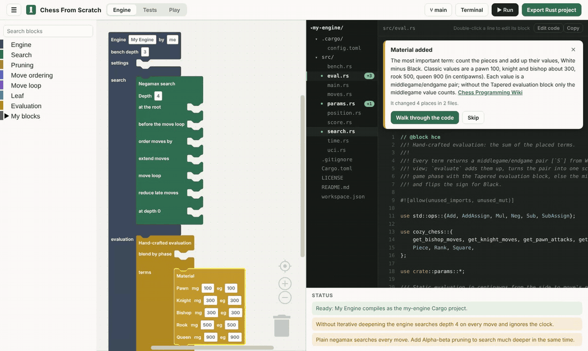
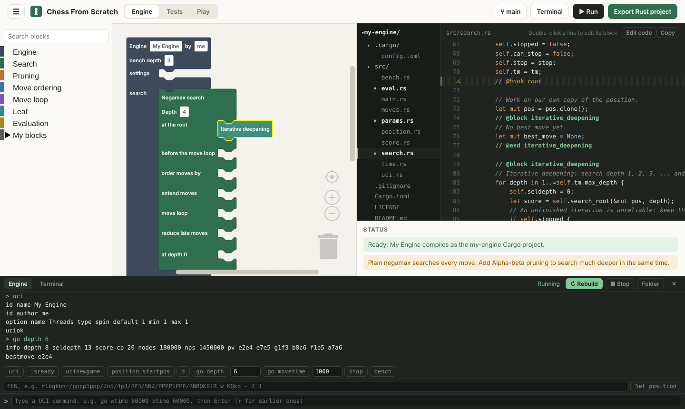
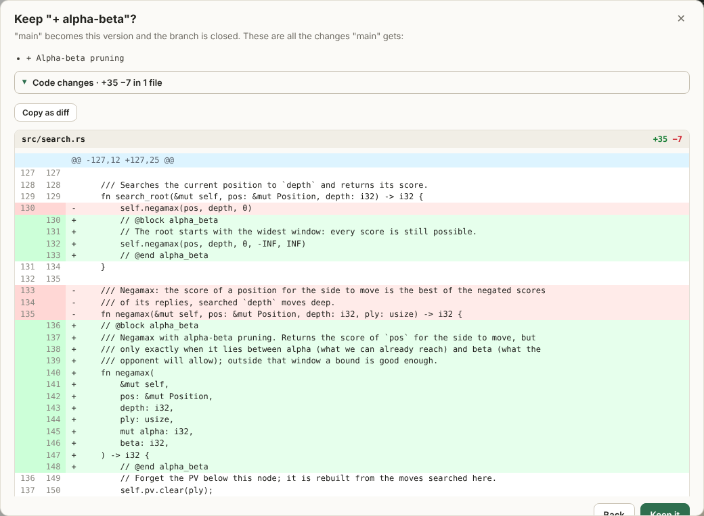
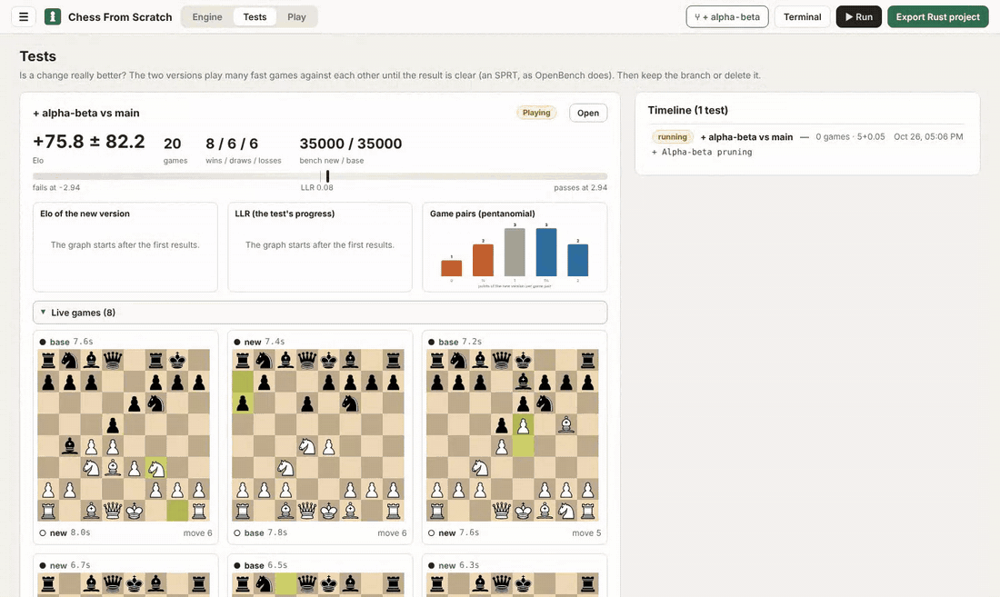
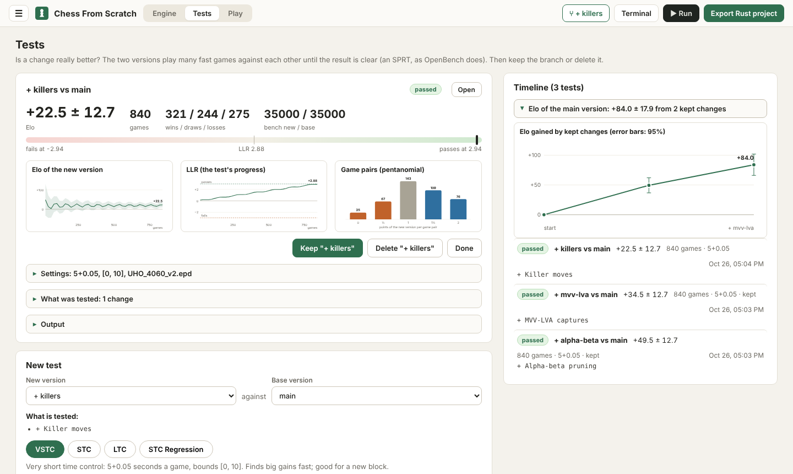
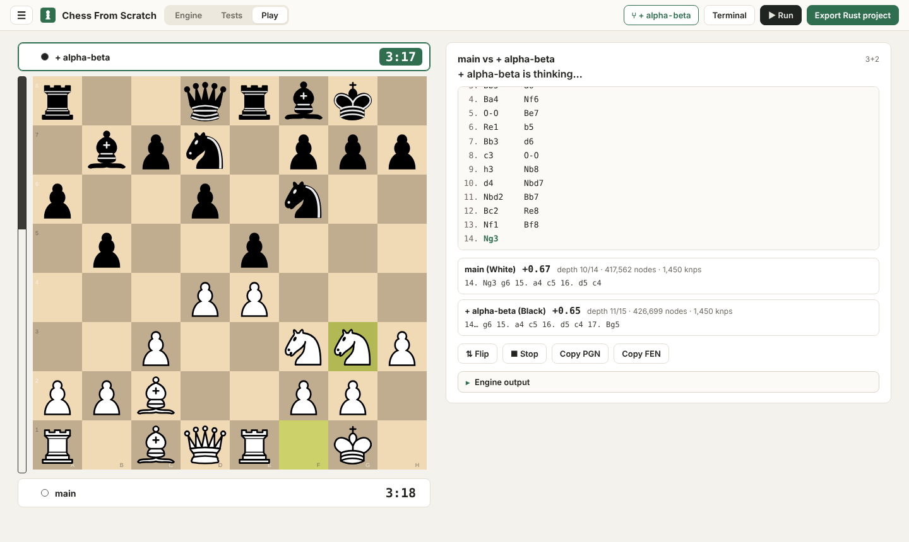

<div align="center">

# Chess From Scratch

**Build your own chess engine by putting blocks together, and learn the real code as you go.**

[**Try it in your browser**](https://chessfromscratch.wgcodings.com) ·
[**Download the desktop app**](https://github.com/WGCodings/Chess-From-Scratch/releases/latest) ·
[Guide](https://github.com/WGCodings/Chess-From-Scratch/wiki)



</div>

Chess From Scratch is a drag-and-drop editor, a bit like Scratch, for making
chess engines. Every block is real Rust code: drop in a search, add pruning
and an evaluation, and the live code view shows exactly which lines each
block adds, with a short explanation. When you are happy, your engine is a
normal Rust project that plays in any chess program. The engine you make is
yours.

It is made for beginners. You don't need to know Rust to start: the built-in
tutorials take you from an empty canvas to a tested, stronger engine in about
half an hour.

## The whole engine developer's loop

<table>
<tr>
<td width="50%" valign="top">

**Build and run.** Blocks on the left, the generated code on the right.
One click on **▶ Run** builds the engine with cargo and lets you talk to it
in UCI.

</td>
<td width="50%" valign="top">

**Branch and see every change.** Try an idea in a copy of your engine.
Before you keep it, you see every changed line, like `git diff`.

</td>
</tr>
<tr>
<td></td>
<td></td>
</tr>
</table>

**Test it like the pros.** The two versions play many fast games against each
other with [fastchess](https://github.com/Disservin/fastchess) until an SPRT
decides, just like OpenBench. You get Elo with its error, the LLR, the game
pairs, and a timeline of every change you kept. Watch the games live, one
board per game:



<table>
<tr>
<td width="50%" valign="top">

**Follow your engine's strength.** Every test is saved with what it
measured, its settings and its code diff. Kept changes add up on the Elo
chart.

</td>
<td width="50%" valign="top">

**Play it.** Play any branch of your engine on the board, or let two
branches play each other. You see what the engine thinks: its score, depth
and the line it expects.

</td>
</tr>
<tr>
<td></td>
<td></td>
</tr>
</table>

## Try it

Open **[chessfromscratch.wgcodings.com](https://chessfromscratch.wgcodings.com)**
and pick **☰ > Tutorial: your first engine**. Nothing to install: the editor
runs in your browser and your work stays on your computer. Export your engine
and build it with [Rust](https://rustup.rs).

The website is the demo. The **desktop app** (Windows, macOS, Linux) is the
full program: the same editor plus **Run**, a terminal, **Tests** and
**Play**, and it works offline. Get it from the
[Releases page](https://github.com/WGCodings/Chess-From-Scratch/releases/latest);
you also need [Rust](https://rustup.rs).

## What you can do

- Start from an empty canvas, a starter engine, or an engine with every block.
- Add blocks one at a time: alpha-beta, null move pruning, late move
  reductions, quiescence search, killers, a tapered evaluation and more.
  Right-click any block to see what it does, line by line.
- Change any block, write your own, and build one on top of another.
- Try ideas in branches, then keep them or delete them.
- Test a branch against your main version with SPRT and follow your engine's
  Elo over time.
- Play against any branch, or let two branches play each other.
- Write code in VS Code: link a folder and your changes come back as blocks.
- Export a complete Rust project with a `bench` command, ready for
  [fastchess](https://github.com/Disservin/fastchess) and
  [OpenBench](https://github.com/AndyGrant/OpenBench).

## Learn more

The **[guide](https://github.com/WGCodings/Chess-From-Scratch/wiki)** explains
everything in simple steps: your first engine, the blocks, changing and making
blocks, branches, testing and playing. It is also in the app (**☰ > Guide**).

## Feedback

Found a bug, got stuck, or have an idea? Please
[open an issue](https://github.com/WGCodings/Chess-From-Scratch/issues). Want
to help with the code? See [CONTRIBUTING.md](CONTRIBUTING.md) and
[docs/DEVELOPMENT.md](docs/DEVELOPMENT.md).

## Run it yourself

```sh
npm install
npm run dev       # the editor at http://localhost:5173
npm run desktop   # the desktop app (needs the Tauri prerequisites)
```

To host the website, see [deploy/README.md](deploy/README.md).
`npm run media -w @cfs/web` makes the pictures above again.

## License

The app is open source under the [GNU AGPL v3](LICENSE). The Rust code that
ends up in your engine (the templates and example blocks) is MIT licensed, and
every exported engine comes with an MIT license in your name. The board is
[chessground](https://github.com/lichess-org/chessground) (GPL-3.0) and the
chess rules come from [chess.js](https://github.com/jhlywa/chess.js) (BSD-2-Clause).
